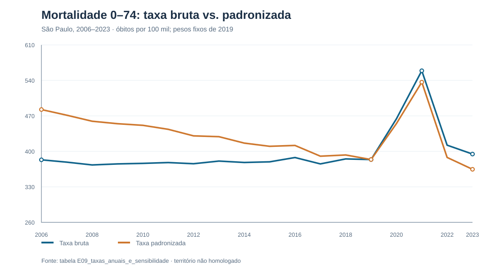
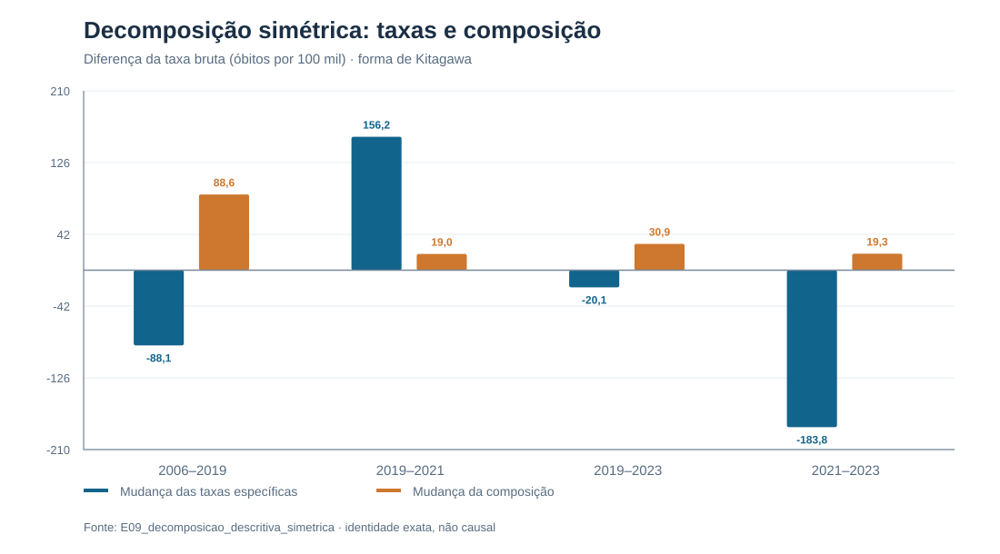
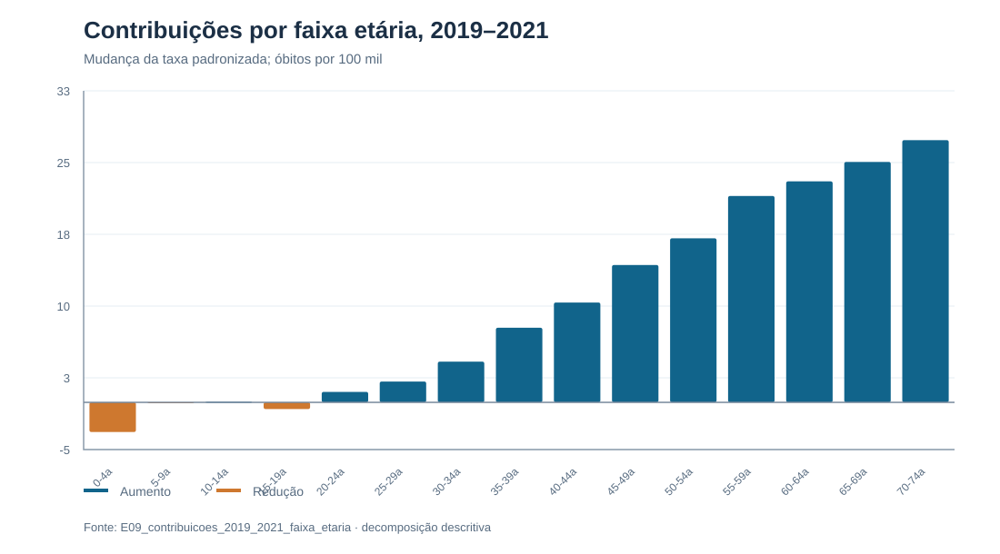
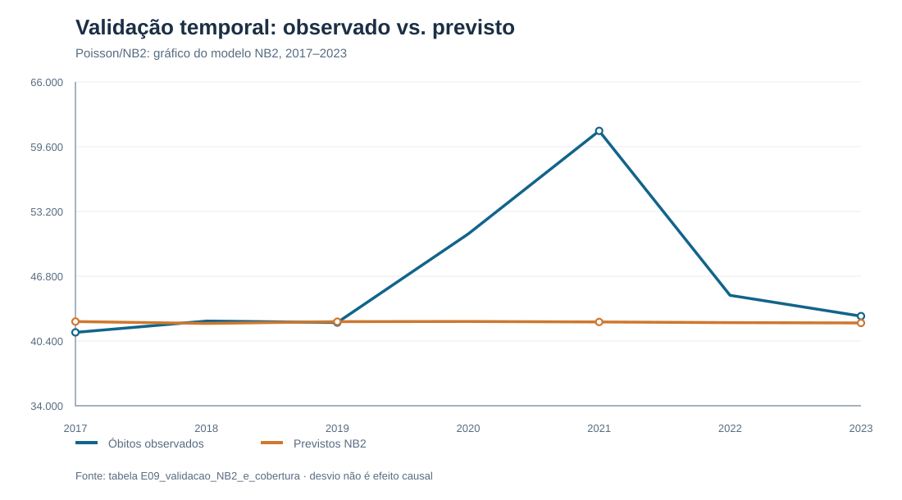

# Caderno evolutivo — Estudo de mortalidade 0–74 em São Paulo (E01–E10)

**Consolidação em 28 de outubro de 2026.** As seções E09 e E10 abaixo preservam a interpretação substantiva registrada e acrescentam a síntese de comunicação/reprodutibilidade. As etapas anteriores são resumidas somente no escopo documentado pelos arquivos recebidos; este caderno **não inventa** registros integrais de E01, E02, E03 ou E05.

## 1. Percurso documentado E01–E08

| Etapa | Pergunta pedagógica | Evidência efetivamente disponível |
|---|---|---|
| E01 — Formulação | O que é mortalidade prematura operacionalmente? | Delimitação recuperada nos materiais posteriores: óbitos de 0–74 anos, 2006–2023, por distrito/sexo/idade. Não há relatório E01 original neste pacote. |
| E02 — Estrutura | O que representa uma linha? | O esquema da base E04 mostra a chave distrito × ano × sexo × faixa quinquenal (51.840 células). Não há caderno E02 independente. |
| E03 — Qualidade | Qual é a integridade e onde falha a comparabilidade? | Relatório E04 e auditorias posteriores: contagens, chaves, exposição positiva, territorialidade pendente. Não há capítulo E03 autônomo. |
| E04 — Base analítica | Como unir óbitos e população? | Script e relatório E04 disponíveis. Base derivada preservada; os três CSVs primários e a homologação territorial estão ausentes. |
| E05 — Exploração | Que padrões motivam as comparações? | Exploração recuperável das tabelas E06–E09; não há relatório E05 original no pacote. |
| E06 — Modelo | Que processo de contagem foi adotado? | documento E06 no pacote de continuidade histórico (não versionado neste GitHub): Poisson e NB2, exposição, idade, sexo, distrito e tendência. |
| E07 — Execução | Quais saídas R foram de fato produzidas? | Script E07 e resultados R E07 com sessionInfo, diagnósticos e validação temporal. Ajuste realizado anteriormente pelo usuário. |
| E08 — Crítica | As previsões se sustentam? | documento E08 no pacote de continuidade histórico (não versionado neste GitHub): diagnóstico, bootstrap de cobertura, sensibilidade e limites. |

A unidade **não** é pessoa. Uma linha é uma célula de combinação de atributos. A população anual é denominador aproximado; somá-la por 18 anos produz unidades de exposição somadas, não o número de habitantes de um único ano. O rótulo “APVP” é o tabulador de origem e a coluna `obitos` contém contagens, **não anos potenciais de vida perdidos**. A janela 0–74 é convenção operacional explícita.

Um erro estrutural importante foi identificado na compatibilidade entre códigos distritais: os códigos APVP e SEADE não obedecem a uma simples regra de soma de 80.000 em 60 dos 96 distritos. A ligação adotada nominalmente é provisória; uma junção que preserva o número esperado de linhas não comprova que os territórios históricos sejam equivalentes.

## 2. Capítulo de interpretação E09 — preservado

# E09 — Interpretar a mortalidade observada sem confundir composição, tendência e previsão

**São Paulo, 2006–2023.** Consolidação de 28 de outubro de 2026.

> **Nota de publicação no GitHub:** os gráficos SVG abaixo foram reconstruídos a partir dos CSVs auditados da E09 para leitura no repositório. Os PNGs e o registro histórico de execução continuam preservados no pacote E10 original; a reconstrução visual não altera os resultados.

## 1. O problema substantivo

O estudo de 51.840 combinações de distrito administrativo, ano, sexo e faixa quinquenal de idade reúne **778.039 registros de óbito** de pessoas com 0–74 anos e **196.070.964 unidades de população anual somadas ao longo de 18 anos**. A última soma **não** é a população da cidade em um ano; é a soma de estimativas anuais utilizadas como aproximações de exposição nas células. Há 96 distritos, 18 anos, dois sexos e 15 faixas etárias, com uma linha para cada combinação. A fonte é a **base analítica E04 PROVISÓRIA**, recebida no pacote E09.

A pergunta substantiva é: **como mudou a mortalidade registrada em pessoas de 0–74 anos entre 2006 e 2023, separando a evolução das taxas específicas da mudança da composição por idade e sexo, e o que a validação preditiva permite dizer?** A presença de dados de mortalidade durante a pandemia não identifica, por si, mortes causadas pela pandemia.

O pacote integral de origem passou por verificação de **105 arquivos e 0 incidentes** no manifesto SHA-256. Isso prova integridade de transmissão dos arquivos enumerados, **não a validade epidemiológica da base**. A verificação executada nesta E09 reconfirmou chave única nas 51.840 células, denominadores estritamente positivos, totais e ausência de homologação territorial em todas as células.

## 2. Por que taxas brutas e padronizadas contam histórias diferentes

Se `obitos` representa Y e `populacao` representa P na célula distrito d, ano t, sexo s, faixa a, calculamos a **taxa bruta anual** assim:

$$
R_t=10^{5}\,\frac{\sum_{d,s,a}Y_{dtsa}}{\sum_{d,s,a}P_{dtsa}}.
$$

Em 2019, por exemplo, `obitos` somam 42.225 e `populacao` soma 10.999.233, resultando em **383,89 óbitos por 100 mil habitantes estimados na faixa de 0–74 anos**. Uma taxa populacional não deve ser obtida pela média simples de taxas dos 96 distritos ou das 2.880 células anuais: cada célula possui um denominador diferente.

A população estudada mudou de composição: a participação estimada das pessoas de **55–74 anos** dentro da faixa de 0–74 passou de **12,53% em 2006** para **18,13% em 2019** e **20,29% em 2023**. Isso pode elevar a taxa bruta, mesmo com taxas específicas menores em muitas faixas.

Para comparar anos com **a mesma distribuição idade × sexo**, utilizamos a padronização direta com a população interna de 2019:

$$
w_{sa}^{2019}=\frac{\sum_d P_{d,2019,s,a}}{\sum_{d,s,a}P_{d,2019,s,a}},\qquad
R_t^{pad2019}=10^{5}\sum_{s,a}w_{sa}^{2019}\frac{\sum_dY_{dtsa}}{\sum_dP_{dtsa}}.
$$

Os **30 pesos fixos** somam 1. É uma convenção analítica interna, **não** um padrão epidemiológico oficial. Ela mantém idêntica a composição por idade e sexo, mas não elimina incerteza de limites distritais, denominadores, registro ou causas de morte.

| Ano | Óbitos | População estimada 0–74 | Bruta, por 100 mil | Padronizada 2019, por 100 mil |
|---|---:|---:|---:|---:|
| 2006 | 40.749 | 10.630.055 | 383,34 | 482,54 |
| 2019 | 42.225 | 10.999.233 | 383,89 | 383,89 |
| 2020 | 50.977 | 10.982.093 | 464,18 | 454,80 |
| 2021 | 61.166 | 10.940.610 | 559,07 | 536,57 |
| 2022 | 44.914 | 10.895.443 | 412,23 | 388,05 |
| 2023 | 42.857 | 10.859.080 | 394,67 | 364,64 |

. A tabela integral contém os 18 anos: [consultar CSV](../../data/raw/mortalidade_sp_0_74/resultados_auditados/E09_taxas_anuais_e_sensibilidade.csv).

**Primeira interpretação:** de 2006 a 2019, a taxa bruta praticamente não mudou (**+0,55 por 100 mil**), enquanto a padronizada com pesos de 2019 caiu **98,65 por 100 mil**, ou cerca de **20,4%** de seu nível em 2006. A estabilidade bruta encobriu a queda das taxas específicas resumidas sob composição fixa.

**Segunda interpretação:** de 2019 a 2021, a taxa bruta aumentou de 383,89 para 559,07 (**+175,18 por 100 mil; +45,6%**); a padronizada passou de 383,89 para 536,57 (**+152,68 por 100 mil; +39,8%**). A elevação persiste após igualar a composição por idade e sexo, não sendo explicável somente pelo envelhecimento medido na base.

**Terceira interpretação:** de 2019 a 2023, a taxa bruta passou a **394,67** (**+2,8%**), enquanto a padronizada caiu a **364,64** (**−5,0%**). A conclusão descritiva para 2023 depende, portanto, da escolha entre um indicador que incorpora composição mutável e outro que fixa a composição de referência.

## 3. Separação exata: mudança das taxas versus mudança da composição

Uma padronização fixa é uma primeira comparação. Para separar **algebricamente** os dois componentes de uma diferença bruta, aplicamos uma decomposição simétrica (forma de Kitagawa) para cada estrato k = sexo × faixa etária. Escrevemos $r_{tk}$ para a taxa específica por 100 mil e $w_{tk}$ para o peso do estrato na população anual. Entre dois anos 0 e 1:

$$
\Delta R=R_1-R_0=\Delta R_{\mathrm{taxas}}+\Delta R_{\mathrm{composicao}}.
$$

$$
\Delta R_{\mathrm{taxas}}
=\sum_k (r_{1k}-r_{0k})\,\frac{w_{1k}+w_{0k}}{2}.
$$

$$
\Delta R_{\mathrm{composicao}}
=\sum_k (w_{1k}-w_{0k})\,\frac{r_{1k}+r_{0k}}{2}.
$$

A igualdade é **exata**, sem termo residual. Os valores abaixo estão em óbitos por 100 mil; eles são componentes matemáticos **descritivos, não causalidade atribuível**.

| Período | Diferença bruta | Mudança das taxas específicas | Mudança da composição |
|---|---:|---:|---:|
| 2006–2019 | +0,55 | −88,08 | +88,63 |
| 2019–2021 | +175,18 | +156,17 | +19,02 |
| 2019–2023 | +10,77 | −20,09 | +30,87 |
| 2021–2023 | −164,41 | −183,76 | +19,35 |

A queda de **98,65** por 100 mil na padronização fixa de 2019 não é igual ao componente **−88,08** nesta decomposição: no primeiro cálculo usamos pesos fixos de 2019; no segundo usamos a média simétrica dos pesos de 2006 e 2019. Ambos respondem a perguntas descritivas diferentes, sem contradição.

Assim, no período **2006–2019**, mudanças de composição e taxas específicas se compensaram quase exatamente. Em **2019–2021**, cerca de **89% da diferença bruta**, por esta regra simétrica de decomposição, foi alocada ao componente das taxas específicas e 11% ao da composição. Em **2019–2023**, o componente de taxas é negativo, mas a composição mais velha contribui positivamente para a taxa bruta. Essas percentagens são **partes de uma identidade aritmética condicionada à estratificação**, não frações de mortes causadas por um fator.

.

## 4. A escolha da população-padrão altera o nível, mas preserva a conclusão principal

Refizemos a padronização com três outros padrões internos: população de **2006**, população somada de **2006–2023** e população de **2023**. Todos incluem os mesmos 30 estratos; nenhum utiliza padrão externo homologado.

| Padrão de pesos | 2019 → 2021 (variação relativa) | 2019 → 2023 (variação relativa) |
|---|---:|---:|
| 2006 | +37,6% | −5,0% |
| 2019 (principal) | +39,8% | −5,0% |
| 2006–2023 (pooled) | +39,2% | −5,0% |
| 2023 | +40,1% | −5,0% |

A magnitude percentual de 2019–2021 muda alguns pontos percentuais com os pesos, mas seu **sinal e sua ordem de grandeza** permanecem. A queda padronizada de 2019–2023 é estável nesses padrões internos. A sensibilidade entre pesos ajuda a avaliar dependência da escolha do padrão; **não** valida as estimativas populacionais da fonte.

## 5. A mudança não se distribuiu igualmente entre as faixas etárias

No intervalo 2019–2021, as 30 células municipais agregadas por sexo × idade produziram uma elevação de **152,68 por 100 mil** na taxa padronizada. A contribuição de cada estrato é `w_{2019,k}(r_{2021,k}−r_{2019,k})`; portanto, o número não é a taxa específica nem uma quantidade de mortes atribuíveis.

**Um exemplo inteiramente extraído da base:** para homens de 65–69 anos, os registros indicam **4.208 óbitos / 184.792 habitantes estimados em 2019**, contra **6.312 / 198.632 em 2021**. A taxa específica sobe de **2.277,15** para **3.177,74 por 100 mil**, uma razão descritiva de **1,395**. O peso de 2019 desse estrato na população 0–74 total é cerca de **0,0168**. A contribuição para a diferença padronizada é `(3.177,74−2.277,15)×0,0168 ≈ 15,13 por 100 mil`. Esse valor vem de **um dos 30 estratos** e não é o aumento da taxa geral.

Somadas as faixas **55–74 anos dos dois sexos**, a contribuição à variação padronizada de 2019–2021 foi de aproximadamente **98,51 por 100 mil**, representando **64,5%** da diferença padronizada total. Entre os **18.941 óbitos observados adicionais** (2021 menos 2019), **13.043** ocorreram nas faixas de 55–74 anos; essa contagem bruta não é comparável diretamente à contribuição padronizada. Na faixa de **0–4 anos**, a contribuição foi negativa (aproximadamente **−3,14 por 100 mil**). O padrão não autoriza identificar quais causas específicas de morte mudaram.

.

Por sexo, a padronização **da idade dentro de cada sexo** com pesos específicos de 2019 produziu:

| Sexo | Taxa em 2019 | Taxa padronizada em 2021 | Razão de taxas |
|---|---:|---:|---:|
| Feminino | 293,39 | 410,88 | 1,400 |
| Masculino | 483,16 | 674,44 | 1,396 |

As bases de comparação dos dois sexos diferem; essas razões não indicam equivalência de riscos individuais nem igual distribuição das causas de morte. A maior taxa absoluta masculina não deve ser confundida com maior aumento **relativo** no período.

## 6. O que de fato aprendemos com a previsão NB2

A E07 ajustou, **no R do usuário**, modelos Poisson e binomial negativa NB2, usando o `offset(log(populacao))`, idade × sexo, efeito fixo de distrito e tendência temporal linear para o exercício de validação temporal. A E08 confrontou os modelos. A NB2 mostrou resultados melhores de logscore médio e cobertura celular nos sete anos analisados, mas **não foi homologada para previsões futuras sob choques**.

Na parametrização adotada:

$$
Y_i \mid \mu_i,\theta\sim NB2(\mu_i,\theta),\quad
\mathrm{Var}(Y_i\mid\mu_i)=\mu_i+\frac{\mu_i^2}{\theta},\quad
\log(\mu_i)=\log(P_i)+\eta_i.
$$

A `P_i` entra como exposição conhecida condicionalmente (offset); `mu_i` é **a média prevista de óbitos**, não uma taxa nem um contrafactual causal identificado. A heterogeneidade entre células se expressa em `eta_i`, com idade, sexo, interação, distrito e ano. A NB2 admite variância maior que a Poisson. Isso **não** elimina automaticamente correlação temporal, sub-registro, mudanças territoriais ou choques não representados.

| Ano teste | Observados | Previstos NB2 | Observado/previsto | Cobertura celular de 95% |
|---|---:|---:|---:|---:|
| 2017 | 41.251 | 42.323 | 0,975 | 96,94% |
| 2018 | 42.365 | 42.130 | 1,006 | 97,15% |
| 2019 | 42.225 | 42.309 | 0,998 | 96,01% |
| 2020 | 50.977 | 42.332 | 1,204 | 89,38% |
| 2021 | 61.166 | 42.280 | 1,447 | 73,30% |
| 2022 | 44.914 | 42.214 | 1,064 | 94,55% |
| 2023 | 42.857 | 42.180 | 1,016 | 95,69% |

.

Em **2021**, a diferença é **61.166 − 42.279,93 ≈ 18.886 óbitos**, um desvio **de previsão** de **44,7% do valor previsto**. A soma dos desvios para 2020–2023 é **aproximadamente 30.909 óbitos**. **Nenhum desses valores mede excesso de mortalidade causalmente atribuível à pandemia.** O modelo foi treinado até 2019 e extrapolado por horizontes de um a quatro anos; mudança de regime, horizonte e eventual especificação incorreta estão misturados. A quantidade de **18.941** (diferença de óbitos observados entre 2019 e 2021) e a de **18.886** (desvio contra a previsão NB2) têm definições diferentes, apesar da proximidade numérica.

## 7. Incerteza: o que a E08 estimou e o que ainda não foi estimado

A avaliação E08 encontrou, em 2021, cobertura de **73,30%** de intervalos preditivos **celulares** rotulados como 95%. O intervalo por bootstrap de distritos de **69,93% a 76,77%** quantifica heterogeneidade da estimativa de cobertura entre distritos (2.500 reamostragens). **Ele não é** um intervalo de confiança da taxa de mortalidade, do número de mortes, do desvio de 18.886, nem uma distribuição conjunta dos totais esperados.

Os intervalos preditivos celulares originalmente aplicados condicionam nos parâmetros estimados. Não foi realizada propagação integral de incerteza de coeficientes e de dependência entre células para construir intervalo calibrado do total. Portanto, **não há IC95% validado para a diferença agregada 2019–2021, a decomposição, ou para o desvio de previsão de 2021** neste pacote. Também não há desenho amostral ou validação externa que sustente intervalos de confiança epidemiológicos oficiais. A ausência desses intervalos não apaga os valores aritméticos, mas restringe sua extrapolação inferencial.

## 8. Hipóteses rivais e pontos que permanecem abertos

Os resultados são compatíveis com uma **mudança de taxas específicas simultânea a mudanças na composição etária**, mas não identificam por que as taxas mudaram. Explicações alternativas ou adicionais incluem choques temporais (inclusive a pandemia) não representados no modelo, transformações de acesso e registro de óbitos, estimativas populacionais com erro ou mudanças de cobertura, dependência entre observações do mesmo distrito ao longo do tempo, e falta de estabilidade da correspondência administrativa histórica. A base não contém causas básicas de morte nem um desenho de identificação causal.

Todas as **51.840 células** têm `homologacao_territorial = PENDENTE` e nenhuma registra `limite_geografico_validado = SIM`. A documentação histórica alerta que os códigos APVP e SEADE não permitem uma junção por regra aritmética simples em 60 dos 96 distritos; foi adotada correspondência nominal **provisória**. Não é apropriado produzir ranking distrital oficial, risco espacial homologado ou comparação causal entre distritos com este material.

Também não estão presentes os CSVs primários de óbitos APVP, de populações SEADE, o crosswalk nominal original e documentação externa de limites históricos, de modo que a base E04 **não é reconstruível independentemente desde a origem neste ZIP**. Isso é uma lacuna concreta de proveniência, não um impedimento para conferir e interpretar **condicionalmente** as medidas da base derivada.

## 9. O que podemos afirmar e o que seria extrapolação

| Afirmação que os arquivos sustentam | Afirmação que não sustentam |
|---|---|
| A taxa bruta 0–74 estimada subiu 45,6% de 2019 a 2021 na base provisória. | A pandemia causou exatamente essa elevação. |
| A taxa padronizada interna subiu 39,8% e a conclusão persistiu com pesos alternativos. | Temos uma taxa oficial certificada e comparável para todos os anos. |
| Entre 2006 e 2019, a mudança da composição compensou aproximadamente a queda das taxas específicas. | Demonstramos causalmente o efeito do envelhecimento sobre os óbitos. |
| Em 2023, a taxa bruta ficou acima de 2019 e a padronizada ficou abaixo. | O risco individual de morrer em 2023 foi menor para todo indivíduo/grupo. |
| A NB2 subpreviu 2021 e seus intervalos celulares foram insuficientes. | Há 18.886 mortes causalmente atribuíveis à pandemia com IC95% calibrado. |
| A mudança foi heterogênea por idade e sexo. | Determinamos causas específicas, vulnerabilidade territorial ou efeito de serviços. |

## 10. Síntese e recomendação de método

**Síntese:** a mortalidade registrada entre pessoas de 0–74 anos em São Paulo não pode ser lida apenas por contagens totais ou taxas brutas. No período anterior a 2020, as taxas específicas padronizadas caíram enquanto a população estudada ficou proporcionalmente mais velha. Em 2020–2021, houve aumento forte mesmo após fixar a estrutura por idade e sexo. Em 2023, a interpretação de recuperação depende da medida: o agregado bruto ainda está um pouco acima de 2019; com pesos internos de 2019, a taxa está abaixo. A análise de previsões confirma a inadequação do NB2 extrapolado em 2021, mas não transforma desvio de modelo em mortes causais.

**Recomendação para o estudo:** usar **taxa padronizada por idade × sexo** ao comparar a evolução temporal, acompanhada sempre da taxa bruta, dos pesos e de uma sensibilidade ao padrão de população. Apresentar a decomposição como recurso explicativo de contabilidade estatística, não de atribuição causal. Manter a NB2 como **baseline de desempenho condicional**, não como instrumento para quantificar impacto pandêmico ou prever novas rupturas. O relato público ou ranking por distrito deve aguardar os arquivos brutos e a homologação histórica/epidemiológica; para projeções futuras genuínas, será necessário construir outra estrutura temporal e reavaliar calibração e incerteza agregada.

**Status E09:** análise descritiva e interpretação **concluídas no escopo provisório**. A E10 pode consolidar a reprodução e a narrativa, mas qualquer publicação externa requer autorização. A necessidade de homologação territorial não é um novo gate de aprendizagem; é a limitação substantiva específica para determinadas afirmações.

## 11. Reprodutibilidade e prova de execução

Arquivos produzidos:

- `data/raw/mortalidade_sp_0_74/resultados_auditados/E09_taxas_anuais_e_sensibilidade.csv` — 18 anos, taxas e quatro padrões internos.
- `data/raw/mortalidade_sp_0_74/resultados_auditados/E09_pesos_2019_sexo_idade.csv` — pesos 2019 dos 30 estratos.
- `data/raw/mortalidade_sp_0_74/resultados_auditados/E09_decomposicao_descritiva_simetrica.csv` — quatro contrastes, identidade numérica verificada.
- `data/raw/mortalidade_sp_0_74/resultados_auditados/E09_contribuicoes_2019_2021_sexo_idade.csv` e `E09_contribuicoes_2019_2023_sexo_idade.csv` — taxas específicas e contribuições.
- `data/raw/mortalidade_sp_0_74/resultados_auditados/E09_contribuicoes_2019_2021_faixa_etaria.csv` — resumo por idade.
- `data/raw/mortalidade_sp_0_74/resultados_auditados/E09_taxas_por_sexo.csv` — séries estratificadas com idade padronizada dentro do sexo.
- `data/raw/mortalidade_sp_0_74/resultados_auditados/E09_validacao_NB2_e_cobertura.csv` — desempenho e heterogeneidade da cobertura, sem intervalos do total.
- `reports/mortalidade_sp_0_74/figures/E09_01...04...svg` — quatro figuras para estudo.
- `scripts/E09_auditoria_reproducivel.py` (do pacote histórico E09; não versionado neste GitHub) — **executado e conferido** no ambiente do assistente; testa contagens, chaves, somas, pesos, identidade da decomposição e observados contra validação R.
- `scripts/mortalidade_sp_0_74/E09_analise_completa.R` — equivalente **escrito, não executado aqui** (Rscript indisponível). Reproduz as medidas e tabelas a partir do CSV E04 derivado e dos CSVs E07/E08; gráficos podem diferir de aparência.

Entradas preservadas em `dados/`; **não** foram modificadas. Ver [README do estudo](../../scripts/mortalidade_sp_0_74/README.md) para comandos. Não foi feito novo ajuste Poisson, NB2 ou Stan, não foram geradas novas predições nem intervalos inferenciais. A verificação com R ainda depende de uma execução efetiva do script entregue: a concordância Python × R da **E09** não pode ser declarada como testada.

---

# E10 — Comunicar, reproduzir e preservar sem ampliar indevidamente as conclusões

**Estudo:** mortalidade registrada de pessoas de 0 a 74 anos nos distritos administrativos de São Paulo, 2006–2023. **Data:** 28/10/2026. **Modo Estudo.**

## 1. A questão de comunicação não é escolher o gráfico mais bonito

Uma série de mortalidade pode ser corretamente calculada e ainda assim conduzir o leitor a uma conclusão inadequada. O exemplo central deste estudo é 2023: frente a 2019, a taxa bruta ficou 2,8% acima, mas a taxa padronizada por sexo × idade, usando os pesos populacionais internos de 2019, ficou 5,0% abaixo. As duas medidas são matematicamente compatíveis: elas respondem a perguntas diferentes. Apresentar somente uma delas ocultaria parte da história.

Comunicar bem exige declarar **qual população, qual numerador, qual denominador, qual comparação e qual alcance inferencial**. Na E10, não se altera o estimando da E09 nem se recalcula um novo resultado apenas para torná-lo mais publicável. Preservamos as medidas calculadas, explicamos suas consequências e delimitamos o que ainda é desconhecido.

## 2. Uma resposta substantiva em quatro movimentos

**Mudança de 2006 a 2019.** A taxa bruta passou de 383,34 a 383,89 óbitos por 100 mil pessoas estimadas na janela 0–74 anos, diferença de apenas +0,55. A taxa diretamente padronizada com estrutura de 2019 caiu de 482,54 a 383,89, diferença de −98,65 por 100 mil (−20,4%). A decomposição simétrica da diferença bruta associa −88,08 por 100 mil à mudança das taxas específicas e +88,63 à composição populacional. Não se trata de dois resultados contraditórios: o padrão fixo e a decomposição simétrica usam pesos distintos.

**Mudança de 2019 a 2021.** A taxa bruta foi de 383,89 a 559,07 (+45,6%); a padronizada, de 383,89 a 536,57 (+39,8%). Sob a decomposição simétrica, +156,17 por 100 mil está no componente de taxas específicas e +19,02 no componente da composição. O aumento não se esgota em uma mudança da distribuição por idade e sexo.

**Mudança de 2019 a 2023.** A taxa bruta alcançou 394,67 (+2,8%); a padronizada, 364,64 (−5,0%). A decomposição simétrica descreve −20,09 por 100 mil associados às taxas específicas e +30,87 à composição. A conclusão depende do indicador: não há uma única sentença que substitua ambos.

**Validação preditiva.** No ano de 2021, a NB2 ajustada com dados até 2019 produziu 42.279,93 óbitos previstos, ante 61.166 observados (razão 1,447 e diferença de aproximadamente 18.886). Intervalos preditivos celulares com 95% nominal cobriram 73,30% das células. O bootstrap distrital da E08 produziu intervalo de 69,93% a 76,77% para a *cobertura empírica*. Esse intervalo não mede a incerteza do total de óbitos nem da diferença observado–previsto. O desvio é uma falha de previsão perante um choque/regime diferente; **não** identifica causalmente mortes decorrentes da pandemia.

## 3. Por que a padronização pertence ao argumento, não apenas ao apêndice

Para cada ano t e estrato k de sexo × idade, definimos Y(t,k) como a soma de óbitos dos distritos e P(t,k) como a soma das exposições populacionais. A taxa do estrato é r(t,k) = 100.000 × Y(t,k)/P(t,k). Escolhemos w(2019,k) = P(2019,k)/soma_k P(2019,k), que soma 1 entre os 30 estratos. A taxa padronizada de um ano usa soma_k w(2019,k) × r(t,k). Fixar os pesos responde: **como se comparam as taxas específicas se a estrutura por idade e sexo for a mesma?**

No código, essa operação não é `mean(taxa)` nem `sum(óbitos)/sum(população)` aplicado depois de agregações inadequadas. Exige preservar os 30 estratos, estimar as taxas em cada um e recombiná-los com os mesmos pesos. O script [E09_analise_completa.R](../../scripts/mortalidade_sp_0_74/E09_analise_completa.R) contém essas operações literais. O arquivo [E09_pesos_2019_sexo_idade.csv](../../data/raw/mortalidade_sp_0_74/resultados_auditados/E09_pesos_2019_sexo_idade.csv) permite conferir os pesos.

A decomposição simétrica responde outra pergunta: quanto da diferença bruta pode ser atribuído *algebricamente* à troca de taxas específicas e quanto à troca de pesos, usando as médias dos dois períodos? Sua soma é uma identidade exata. Não é atribuição causal do envelhecimento nem do período pandêmico.

## 4. O que a modelagem acrescentou e o que não acrescentou

A E07 ajustou modelos de contagem Poisson e NB2 em R, com `offset(log(populacao))`, efeitos de idade × sexo, efeitos fixos de distrito e tendência temporal. A E08 comparou períodos de teste e examinou calibração, cobertura, sensibilidade e persistência de resíduos entre distritos ao longo de anos. A NB2 serviu como referência entre os modelos avaliados, mas não está homologada para projetar rupturas futuras ou para calcular excesso de mortalidade atribuível a uma causa.

Nenhum modelo Stan foi implementado neste estudo. A simples disponibilidade dos manuais de Stan e Jaynes no projeto não substitui evidência empírica de ajuste, diagnóstico ou identificação causal.

## 5. Três níveis de reprodução diferentes

1. **Recalcular a descrição E09 com entradas congeladas:** possível com `dados/base_analitica_celular_PROVISORIA.csv`, `dados/E07_R_validacao_anual.csv` e `dados/E08_incerteza_cobertura_bootstrap_distrito.csv`. O código Python foi executado anteriormente e a auditoria da E10 reconfirmou os principais números e reexecutou as rotinas Python E08/E09, reproduzindo as tabelas históricas. O script R foi entregue, mas não executado neste ambiente.
2. **Reajustar E07 e reavaliar E08/E09:** possível *em princípio* desde a base E04 derivada, pelo `scripts/mortalidade_sp_0_74/reproduzir_E10.R --modo=completo`, com R e MASS. Esse caminho não foi executado durante a E10. A reamostragem bootstrap em R usa gerador pseudoaleatório diferente daquele de NumPy; os percentis simulados podem variar ligeiramente. O pipeline não deve ser anunciado como testado enquanto não for efetivamente executado.
3. **Reconstruir desde as fontes primárias:** **ainda não é possível** com este pacote. O script E04 exige `obitos_APVP_2006_2023_0a74.csv`, `populacao_SEADE_2006_2023_0a74_LONG.csv` e `crosswalk_distritos_PROVISORIO.csv`, indisponíveis. A documentação sobre a estabilidade dos limites administrativos históricos e dos denominadores também continua pendente. Sem essas fontes não se certifica a correspondência territorial.

Esses três níveis não são equivalentes. Um teste de consistência de uma base derivada não certifica a origem; uma concordância entre duas implementações não valida pressupostos científicos; e convergência numérica de um ajuste não resolve identificação causal.

## 6. Como preservar resultados interpretáveis

A unidade principal é este caderno consolidado. Os diretórios Os diretórios `dados/` e `fontes_historicas/` pertencem ao pacote E10 original. Neste GitHub, os agregados auditados estão em `data/raw/mortalidade_sp_0_74/resultados_auditados/`, as figuras para leitura em `reports/mortalidade_sp_0_74/figures/` e os scripts em `scripts/mortalidade_sp_0_74/`. Saídas regeneráveis são gravadas sob `outputs/mortalidade_sp_0_74/`. O manifesto SHA-256 identifica byte a byte o conteúdo entregue, não sua qualidade estatística. O arquivo `provas/VALIDACAO_PYTHON_E10.json` está no pacote E10 histórico. Aqui, os testes públicos estão em `tests/testthat/test-mortalidade-sp-0-74.R`.

Publicar o repositório não é o mesmo que demonstrar reprodutibilidade desde os dados originais. Se as fontes primárias forem anexadas, reconstruir a E04 em um diretório novo, comparar as chaves e todos os totais, revisar o problema de correspondência territorial e então avaliar se as conclusões agregadas permanecem. Não sobrescrever as evidências congeladas.

## 7. O texto público pode afirmar, sem extrapolar

> No estudo exploratório, a taxa bruta de mortalidade de pessoas de 0 a 74 anos praticamente não mudou entre 2006 e 2019, mas a taxa padronizada por idade e sexo caiu. A diferença decorre da mudança da composição populacional e das taxas específicas, medidas sobre uma base territorial provisória. Entre 2019 e 2021, a alta permanece expressiva após padronização. Os modelos preditivos ajudam a identificar desajustes, mas não estabelecem suas causas.

Não devemos afirmar que a base oferece “riscos individuais”, que o modelo estima “mortes causadas pela pandemia”, que as comparações entre distritos são oficiais ou que há intervalos calibrados de incerteza para a diferença agregada. Também não está autorizado publicar o estudo fora desta conversa; os textos são rascunhos preparados para possível revisão e decisão do usuário.

## 8. Fechamento E10

O ganho do percurso é metodológico: uma boa pergunta exige definir unidade, selecionar o denominador correto, verificar integridade de junções, comparar indicadores sob composições diferentes, compreender o que um modelo prevê e reconhecer quando um resultado não pode ser traduzido em causalidade. O que sabemos é delimitado, mas suficiente para uma conclusão exploratória útil. O que ainda não sabemos está registrado em relação a fontes e verificações concretas, sem reiniciar as dez etapas ou criar novas aprovações formais.

**Concluído:** narrativa, tabelas e gráficos preservados, código de reprodução R organizado, auditorias e reexecuções Python E08/E09 executadas, documentos de publicação redigidos, inventário e manifesto do pacote. **Ainda não demonstrado:** execução R E10, remontagem APVP–SEADE desde fontes primárias, homologação territorial histórica, calibração preditiva agregada e identificação causal. **Próximo passo, apenas se necessário:** executar o comando R disponibilizado ou anexar as fontes primárias para as verificações de procedência e uso territorial que permaneceram abertas.
